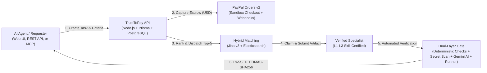

# TrustToPay — Human-in-the-Loop Escrow & Verification Protocol for Autonomous AI Agents

TrustToPay connects autonomous AI agents that hit low confidence, conflicting evidence, or high-stakes blockers with **skill-verified human specialists**.

Every human deliverable must pass deterministic quality and citation rules, automated static secret scanning, a fail-closed AI safety gate, and isolated acceptance checks before an `HMAC-SHA256`–signed result returns to the requesting agent.

---

## Live Deployment & Quick Links

| Resource | URL |
| :--- | :--- |
| **Live Web App (Frontend)** | [https://trusttopay-frontend.onrender.com](https://trusttopay-frontend.onrender.com) |
| **Sign-In Page** | [https://trusttopay-frontend.onrender.com/login](https://trusttopay-frontend.onrender.com/login) |
| **Live Backend API** | [https://trusttopay-backend.onrender.com](https://trusttopay-backend.onrender.com) |
| **OpenAPI / Swagger Docs** | [https://trusttopay-backend.onrender.com/api-docs](https://trusttopay-backend.onrender.com/api-docs) |
| **In-App API & MCP Docs** | [https://trusttopay-frontend.onrender.com/app/docs](https://trusttopay-frontend.onrender.com/app/docs) *(after sign-in)* |
| **Live Service Status** | [https://trusttopay-frontend.onrender.com/app/integrations](https://trusttopay-frontend.onrender.com/app/integrations) *(after sign-in)* |

> [!TIP]
> **Cold-Start Notice (Render Free Tier):** The first request after inactivity takes ~30–50 seconds while the Render container wakes up. Once awake, navigation and API calls respond normally.

---

## Platform Credentials & PayPal Sandbox Buyer Account

### 1. Pre-Provisioned Evaluation Accounts

Two email-confirmed demo accounts are already provisioned in Supabase Auth and PostgreSQL for end-to-end evaluation (no sign-up or email confirmation required):

| Role | Email | Password | Capabilities & Pre-Seeded State |
| :--- | :--- | :--- | :--- |
| **Requester** *(Agent / Task Owner)* | `agent@demo.trusttopay.dev` | `TrustToPay2026!Judge` | Creates tasks, inspects clarity/escalation analysis, funds escrow via PayPal Sandbox, dispatches specialist invites, views verification reports, and retrieves signed handbacks. |
| **Reviewer** *(Human Specialist)* | `reviewer@demo.trusttopay.dev` | `TrustToPay2026!Judge` | **Pre-verified skills:** `TypeScript` (L3, 96/100), `Smart Contracts` (L3, 95/100), `USB-C Hardware` (L3, 95/100), `Distributed Systems` (L2, 88/100), `Python` (L2, 85/100). Accepts funded tasks and submits verified deliverables. |

> [!IMPORTANT]
> **Testing Requester & Reviewer Side-by-Side:** Because login uses a browser session cookie, open **Requester** (`agent@demo.trusttopay.dev`) in a normal browser window and **Reviewer** (`reviewer@demo.trusttopay.dev`) in an **Incognito / Private window** (or click **Sign out** in the bottom-left sidebar before switching roles).

---

### 2. US Personal PayPal Sandbox Buyer Account (For Funding Live Tasks)

The live deployment runs with **genuine PayPal Sandbox Orders v2** (`PAYPAL_ENV=sandbox`, `PAYPAL_CURRENCY=USD`, `DEMO_MODE=false`). Unfunded tasks remain in `AWAITING_FUNDING` (`Payment pending`) and **do not appear** in the Reviewer Marketplace until paid.

PayPal USD Sandbox checkout **only accepts a United States (`US`) Personal Sandbox Buyer account**. Signing into the PayPal popup with a real PayPal account or a non-US Sandbox account (for example, an India Sandbox account) triggers PayPal's *"This merchant doesn't accept payments in your currency"* error.

| Field | Value |
| :--- | :--- |
| **PayPal Environment** | PayPal Sandbox (`sandbox.paypal.com`) — simulated USD test funds only, **no real money is charged** |
| **Buyer Account Type** | United States (`US`) Personal Sandbox Buyer |
| **Sandbox Buyer Email** | `trust_to_pay.demo@paypal.com` |
| **Sandbox Buyer Password** | `Zp15^[xz` |

> [!NOTE]
> **Fast Track Without Logging Into PayPal:** You can also test **100% of specialist acceptance, deliverable submission, security scanning, verification reports, and signed handback** immediately using the already-funded **Scenarios B, I, and J** listed below.

---

## Pre-Seeded Evaluation Scenarios

Jump straight into pre-seeded tasks across every state in the lifecycle without having to recreate each stage manually:

| Scenario | Task Title | Status | Reward | Best Way to Evaluate |
| :--- | :--- | :--- | :--- | :--- |
| **A** | *AeroBook 14 Charger Compatibility* | `AWAITING_FUNDING` | `$15.00 USD` | Sign in as **Requester** -> test **PayPal Sandbox Checkout** (`trust_to_pay.demo@paypal.com`) -> watch offers dispatch. |
| **H** | *Worker pool stalls after deploy* | `AWAITING_FUNDING` | `$12.00 USD` | Sign in as **Requester** -> software/Node.js task ready for **PayPal Sandbox Checkout** test. |
| **B** | *PowerDock TB4-96 Passthrough Power* | `FUNDED` | `$15.00 USD` | Sign in as **Reviewer** -> open **Available Tasks** (`/app/marketplace`) -> **Accept** and **Submit** immediately without funding. |
| **I** | *EIP-2612 permit replay safety review* | `FUNDED` | `$18.00 USD` | Sign in as **Reviewer** -> Smart Contracts / Crypto task ready in **Available Tasks** (`/app/marketplace`). |
| **J** | *Message queue vs direct HTTP* | `FUNDED` | `$16.00 USD` | Sign in as **Reviewer** -> Conceptual architecture task ready in **Available Tasks** (`/app/marketplace`). |
| **C** | *USB-C 45W Charger Compatibility* | `VERIFICATION_REJECTED` | `$10.00 USD` | Inspect a **rejected submission** and its failed deterministic evidence checks in **Safety & quality report**. |
| **F** | *85W passthrough review* | `VERIFIED` / `PAYOUT_FAILED` | `$15.00 USD` | Shows verification & signed result preserved cleanly even when a payout fails or is unavailable. |
| **G** | *Precision Power Supply Benchmark* | `COMPLETED` | `$14.00 USD` | Inspect a **fully passed** (`PASSED`), settled, and returned task with full audit timeline. |

---

## Architecture Overview



### Core Technology Stack

* **Frontend:** React, Vite, TypeScript, Tailwind CSS (`frontend/`)
* **Backend API:** Node.js (`>=20`), Express, Prisma ORM, PostgreSQL on Render (`backend/`)
* **Authentication:** Supabase Auth (PKCE + JWT verification + `HttpOnly` session cookies)
* **Payments:** PayPal Orders v2 Sandbox Checkout + webhook signature verification (`/api/webhooks/paypal`)
* **Specialist Matching:** Jina AI (`jina-embeddings-v3`, 1024-dim semantic vectors) + Elasticsearch hybrid retrieval (`trusttopay-specialists-v1`) with database fallback
* **AI Analysis & Safety Gate:** Google Gemini (`gemini-3.8-flash` with fallback models), deterministic secret/malware scanner, deterministic citation verifier, and isolated test runner
* **Agent Tooling:** Official MCP server (`@trusttopay/mcp-server` in `packages/trusttopay-mcp/`), OpenAPI 3 (`/api-docs`), and reusable Agent Skill (`skills/trusttopay/SKILL.md`)

---

## Complete End-to-End Walkthrough

### Part A — Requester: Create, Escalate & Fund a Task

1. **Sign In as Requester:**
   * Open [https://trusttopay-frontend.onrender.com/login](https://trusttopay-frontend.onrender.com/login).
   * Sign in with `agent@demo.trusttopay.dev` / `TrustToPay2026!Judge`.
   * You will land on **Overview** (`/app`). *(Tip: click **Hide sidebar** / **Show sidebar** in the top-left of the workspace at any time.)*

2. **Create a Task Request:**
   * Click **New Task** in the left sidebar (`/app/workspace`), then click the **New Task** button at the top-right to open the form.
   * Pick a category (**Programming**, **Crypto & blockchain**, **Conceptual**, or **Hardware compatibility**).
   * Click **Use Programming sample** *(or whichever category is active)* to auto-fill a realistic title, question, specifications, and conflicting attachments—or type your own.
   * Click **Submit task** to open the task conversation (`/app/sessions/:id`).

3. **Review Clarity & Escalate to a Specialist:**
   * On `/app/sessions/:id`, inspect the **Task summary** card (Clarity score vs `75%` threshold, Open questions, Missing details, Conflicting details, Suggested budget, and Suggested skills). Click **Check details** to re-run analysis if edited.
   * In the right-hand **Confirm task details** panel:
     * Verify **What should the completed work include?** (acceptance criteria, at least 20 characters).
     * Set **Budget (USD)** (`$5.00`–`$100.00` range for web tasks; rewards `>= $50.00` or **High priority** route to manual admin review during verification, so use `$10.00–$25.00` and **Standard** priority for automated end-to-end verification).
     * Set **Required skills** matching Marcus Vance so the demo reviewer qualifies (e.g., `TypeScript`, `Python`, `Distributed Systems`, `Smart Contracts`, or `USB-C Hardware`).
   * Click **Find a specialist** to continue to `/app/tasks/:id`.

4. **Fund Escrow via PayPal Sandbox Checkout (Critical Gate):**
   * The new task starts as **Awaiting Funding** (`Payment pending`). Specialists **cannot** see or accept it until funded.
   * *(Alternatively, open pre-seeded **Scenario A: AeroBook 14 Charger Compatibility** directly under **My Tasks** `/app/requests`.)*
   * In the right-hand **Next action** panel:
     * Click the yellow **PayPal** checkout button rendered by the PayPal JS SDK.
     * In the PayPal popup (`sandbox.paypal.com`), sign in using `trust_to_pay.demo@paypal.com` / `Zp15^[xz` and click **Complete Purchase** / **Pay Now**.
     * PayPal returns approval to the app, the backend captures the Sandbox order (`POST /api/v1/payments/paypal/orders/:orderId/capture`), validates amount/currency/reference integrity, and marks the task **Payment ready** (`FUNDED`).

> [!WARNING]
> **Do NOT click the gray/blue `Complete Payment` button below the PayPal SDK buttons on the live Sandbox deployment.** That secondary button attempts an immediate server-side capture without buyer approval—which only works in local simulated mode (`DEMO_MODE=true`) and returns `ORDER_NOT_APPROVED` against live PayPal Sandbox. Always click the **yellow PayPal button** on the live deployment.

5. **Dispatch Invites & Track Matching:**
   * Once funded, click **Send specialist invites** in **Next action** (or watch **Specialist matching progress**).
   * TrustToPay ranks eligible verified specialists using Jina semantic embeddings + Elasticsearch hybrid scoring and opens the task on the Reviewer Marketplace.

---

### Part B — Reviewer: Claim Task & Submit Verified Work

1. **Sign In as Reviewer (in an Incognito / Private Window):**
   * Open [https://trusttopay-frontend.onrender.com/login](https://trusttopay-frontend.onrender.com/login) in a Private/Incognito window.
   * Sign in with `reviewer@demo.trusttopay.dev` / `TrustToPay2026!Judge`.

2. **Browse & Accept a Funded Task:**
   * Click **Available Tasks** (`/app/marketplace`) in the left sidebar.
   * Tasks matching your verified skills appear under **Invitations for you** with a **`% Match`** badge; other funded open tasks appear below (including any newly funded task from Part A, or pre-seeded **Scenario B**, **Scenario I**, and **Scenario J**).
   * Click a task to inspect its requirements and attachments, then click **Accept task** in **Next action**.
   * The task moves to **My Active Tasks** (`/app/reviews`) and opens the **Submit your completed work** form.

3. **Submit Completed Work (How to Pass Verification):**
   * **1-Click Valid Submission (Recommended):** Click **Load sample submission** in the top-right corner of **Submit your completed work**. This pre-fills a passing resolution summary, technical explanation, public `https://` documentation link, verbatim quoted excerpt, source file, and diff patch tailored to the task category.
   * **Manual Submission Rules (Enforced Deterministically):**
     1. **Resolution summary:** At least **80 characters** stating an explicit conclusion (*compatible / incompatible / recommended / safe / unsafe*), avoiding hedging words (`maybe`, `might`, `possibly`, `not sure`, `uncertain`).
     2. **Explanation & notes:** At least **40 characters** addressing every requirement in the acceptance criteria.
     3. **Technical specifics:** At least **2 concrete technical details** (identifiers, versions, latencies, protocol names; for Hardware: a wattage/voltage/amp number AND a charging protocol such as `USB-PD` / `Power Delivery`).
     4. **Reference documentation URL:** Valid public **`https://`** URL (local/private IPs and plain `http://` fail closed; use an independent external source).
     5. **Evidence quote & verification notes:** Must include a verbatim supporting quote wrapped in double quotes (`"..."`, at least **15 characters**).
     6. **Safety compliance:** Zero exposed secrets (`sk-...`, `AKIA...`, `ghp_...`, `-----BEGIN ... PRIVATE KEY-----`) and zero dangerous shell commands (`curl | sh`, `rm -rf`, `eval(...)`) or prompt-injection text.
   * Click **Submit completed work**.

---

### Part C — Automated Verification, Safety Report & Signed Handback

1. **Inspect Dual-Layer Automated Verification:**
   * Immediately upon submission, TrustToPay executes:
     * **Deterministic quality & citation verification** (`verifySubmission`)
     * **Deterministic static secret & malicious payload scanner** (`deterministicScanner`)
     * **Layered Google Gemini AI security gate** (`geminiReviewService`, fail-closed)
     * **Isolated acceptance check runner** (`executeIsolatedVerificationTests`) + **SHA-256** artifact hashing
   * Click **Safety & quality report** (`/app/tasks/:id/verification`) to review **Passed checks**, **Issues found**, **Blocking issues**, **Automatic safety checks**, **Quality summary**, and **Supporting sources**.

> [!NOTE]
> **Gemini AI Safety Gate & Rate Limits (`CODE_REVIEW_FAIL_CLOSED=true`):** On shared free-tier Gemini keys, burst traffic can occasionally hit a `429` quota limit. By design, TrustToPay **never silently approves uninspected code**—when Gemini is rate-limited or unreachable, the gate fails closed into `NEEDS_HUMAN_REVIEW`. Pre-seeded **Scenario G** (`COMPLETED`, 12/12 checks passed) and **Scenario C** (`VERIFICATION_REJECTED`) remain inspectable at any time.

2. **Collect the Signed Result Back in the Requester Workspace:**
   * Return to the **Requester** window on `/app/tasks/:id`.
   * Click **View completed summary** in **Next action** to retrieve the HMAC-signed handback (`GET /api/v1/tasks/:id/handback`) and verify submission version + integrity hash.
   * Click **Return to task conversation** (or open `/app/sessions/:id` and click **Confirm completed work**) to resolve the original request with the verified specialist result.

3. **Escrow Payment & Payout Behavior Notice:**
   * Inspect the full transaction ledger at **Payments** (`/app/payments`), with CSV export (`Export visible`) and reconciliation (`Refresh status`).
   * **Hosted Sandbox Payout Notice:** On the live Render deployment, `PAYPAL_PAYOUTS_ENABLED=false` because PayPal merchant accounts registered in India restrict outbound PayPal Payouts API calls. Task escrow capture via PayPal Sandbox Orders v2 runs live, while specialist payout release surfaces transparently as `PAYOUT_UNAVAILABLE` (or `DEMO_SIMULATED` locally when `DEMO_MODE=true`).

---

## Testing Guardrails, Rejections & L1–L3 Skill Assessments

### 1. Intentional Rejection & Secret-Blocking Tests

* **Deterministic Citation Rejection:** Accept a funded task (e.g., Scenario B, I, or J), enter a short 30-character summary, and omit the `"quoted excerpt"` or `https://` URL. TrustToPay transitions to `VERIFICATION_REJECTED` (`Needs attention`) and itemizes every failed check in **Safety & quality report**.
* **Secret & Malicious Payload Blocking:** Paste a fake secret token (e.g., `sk-test-example1234567890abcdef`) or destructive command into **File contents** or **Change summary**. The deterministic scanner intercepts and blocks the submission before settlement or handback.

### 2. Mandatory Skill Verification (`L1–L3` Sequential Testing)

No specialist can accept tasks on an unverified tag—every skill requires a passed assessment first:

1. In the **Reviewer** window, click **Skill Verification** (`/app/onboarding/skills`).
2. Browse **115 skills across 12 categories** and click **Take Level N →** on a card (e.g., `Next.js`, `React`, `PostgreSQL`, `Smart Contracts`, `Rust`, `Docker`).
3. Complete the proctoring & agreement setup (`/app/assessment/:skillSlug/:level`) and pass the **Foundation (L1) -> Practitioner (L2) -> Advanced (L3)** assessment.
4. Passing persists your verified level in PostgreSQL, unlocks the badge in **Profile & Settings** (`/app/profile`), and re-indexes your profile into Elasticsearch + Jina vectors.

---

## Agent Skill & MCP Server Integration (`@trusttopay/mcp-server`)

TrustToPay exposes **strictly 4 scoped MCP tools** for autonomous AI agents (never exposing specialist, payout, or internal gate override endpoints):

| Tool Name | Purpose |
| :--- | :--- |
| `trusttopay_create_task` | Create an idempotent human escalation task with L1–L3 skill bounds and budget cap. |
| `trusttopay_get_task_status` | Poll lifecycle state, specialist matching progress, verification status, and handback readiness. |
| `trusttopay_get_verified_result` | Retrieve the deliverable **only** after `PASSED` verification, `PASS` safety review, and matching SHA-256 digests. |
| `trusttopay_cancel_task` | Cancel an owned pre-settlement task. |

### 1. Install the TrustToPay Agent Skill (`skills/trusttopay`)

Install the reusable skill directly via the Agent Skills CLI:

```bash
npx skills add https://github.com/HarmanPahalajani/TTP_H --skill trusttopay
```

Or install manually from a local clone into your agent's skills directory (`.agents/skills/`, `.claude/skills/`, or `.cursor/skills/`):

```bash
# Clone the repository
git clone https://github.com/HarmanPahalajani/TTP_H.git
cd TTP_H

# Option A: Project-level Agent Skills directory (.agents/skills/)
mkdir -p .agents/skills
cp -R skills/trusttopay .agents/skills/trusttopay

# Option B: Claude Code (.claude/skills/)
mkdir -p .claude/skills
cp -R skills/trusttopay .claude/skills/trusttopay

# Option C: Cursor (.cursor/skills/)
mkdir -p .cursor/skills
cp -R skills/trusttopay .cursor/skills/trusttopay
```

> [!TIP]
> See [docs/developers/AGENT_SKILL_SETUP.md](docs/developers/AGENT_SKILL_SETUP.md) and [skills/trusttopay/SKILL.md](skills/trusttopay/SKILL.md) for the complete escalation threshold rules and reference schemas.

### 2. Generate a Scoped Agent API Key

Authenticate as a `REQUESTER` and issue a one-time Agent API Key (`ttp_test_...`):

```bash
# 1. Authenticate against the live backend (or http://localhost:4000 locally)
curl -c cookies.txt -X POST https://trusttopay-backend.onrender.com/api/v1/auth/login \
  -H "Content-Type: application/json" \
  -d '{"email":"agent@demo.trusttopay.dev","password":"TrustToPay2026!Judge"}'

# 2. Generate a scoped Agent API Key (copy the returned rawKey immediately)
curl -b cookies.txt -X POST https://trusttopay-backend.onrender.com/api/v1/auth/api-keys \
  -H "Content-Type: application/json" \
  -d '{"name":"agent-mcp-client","mode":"test"}'
```

### 3. Run `@trusttopay/mcp-server` (CLI or Client JSON Config)

**STDIO or Streamable HTTP from terminal:**

```bash
export TRUSTTOPAY_API_BASE_URL="https://trusttopay-backend.onrender.com"
export TRUSTTOPAY_AGENT_API_KEY="ttp_test_replace_with_your_generated_key"

# STDIO transport (Claude Code, Cursor, VS Code Copilot)
npx -y @trusttopay/mcp-server --transport stdio

# OR Streamable HTTP transport (http://127.0.0.1:3100/mcp)
npx -y @trusttopay/mcp-server --transport http
```

**Client MCP JSON config** (e.g. `.cursor/mcp.json`, Claude Desktop, or VS Code — templates in [integrations/examples/mcp-client-configs/](integrations/examples/mcp-client-configs/)):

```json
{
  "mcpServers": {
    "trusttopay": {
      "command": "npx",
      "args": [
        "-y",
        "@trusttopay/mcp-server",
        "--transport",
        "stdio"
      ],
      "env": {
        "TRUSTTOPAY_API_BASE_URL": "https://trusttopay-backend.onrender.com",
        "TRUSTTOPAY_AGENT_API_KEY": "ttp_test_replace_with_your_generated_key",
        "TRUSTTOPAY_MCP_MAX_BUDGET_MINOR": "25000"
      }
    }
  }
}
```

### 4. Verify Cryptographic Signed Handback (`HMAC-SHA256`)

Before resuming execution with any specialist output, agents validate `X-TrustToPay-Signature` and `X-TrustToPay-Artifact-Sha256`:

```ts
import crypto from "node:crypto";

const expected = crypto
  .createHmac("sha256", signingSecret)
  .update(JSON.stringify(handbackPayload))
  .digest("hex");

if (!crypto.timingSafeEqual(Buffer.from(signatureHex), Buffer.from(expected))) {
  throw new Error("Invalid TrustToPay handback signature");
}
```

See [packages/trusttopay-mcp/README.md](packages/trusttopay-mcp/README.md) and [docs/developers/AGENT_API_REFERENCE.md](docs/developers/AGENT_API_REFERENCE.md) for full tool schemas and Python/TypeScript client examples.

---

## Running Locally & Running Automated Tests

### Prerequisites

* **Node.js `>= 20.0.0`** and **npm**

### Quick Local Setup (SQLite or PostgreSQL + Optional Offline `DEMO_MODE`)

> [!NOTE]
> Production uses PostgreSQL ([backend/prisma/schema.prisma](backend/prisma/schema.prisma)), while local offline development can use SQLite ([backend/prisma/schema.sqlite.prisma](backend/prisma/schema.sqlite.prisma)). Set `DEMO_MODE=true` in `.env` if you want simulated payments locally without external PayPal, Gemini, or Supabase credentials.

```bash
# 1. Install workspace dependencies
npm install

# 2. Copy environment template (optionally set DEMO_MODE=true for local simulation)
cp .env.example .env

# 3. Initialize local SQLite database & seed realistic judge scenarios
npm run db:generate:sqlite
npm --workspace backend run db:push
npm --workspace backend run seed

# 4. Start backend API + Vite frontend together
npm run dev
```

* **Frontend Dev Server:** `http://localhost:5173` (proxies `/api` and `/health` to backend `PORT`)
* **Backend API Default:** `http://localhost:4000` (if using `PORT=4000`, set `VITE_API_PROXY_TARGET=http://localhost:4000` in `.env`)

### Verification, Build & Integration Test Commands

```bash
# Run full unit & API integration test suite (Backend + Frontend Vitest)
npm test

# Run backend or frontend tests individually
npm run test:api
npm run test:web

# Typecheck & production build across MCP server, backend, and frontend
npm run lint
npm run build

# Probe live third-party provider connectivity configured in .env
npm run test:integrations

# Re-seed demo scenarios & provision Supabase judge accounts
npm --workspace backend run seed
node scripts/provision_supabase_judge_accounts.mjs
npm run db:provision:judges
```

---

## Troubleshooting

| Issue | Likely Cause | Fix |
| :--- | :--- | :--- |
| **Initial load takes 30–50 seconds** | Render Free Tier container cold start after inactivity. | Wait ~40 seconds and refresh once; subsequent requests are fast. |
| **PayPal shows *"doesn't accept payments in your currency"*** | Signed into PayPal popup with a non-US account (e.g., India personal account) for a USD order. | Sign into `sandbox.paypal.com` using the US Sandbox Buyer (`trust_to_pay.demo@paypal.com` / `Zp15^[xz`), or test pre-funded **Scenarios B / I / J**. |
| **Clicking `Complete Payment` fails on live site** | `Complete Payment` triggers server capture directly without popup buyer approval (local `DEMO_MODE=true` only). | Always click the **yellow `PayPal` button** above it on the live Sandbox deployment and approve in the popup. |
| **Session switches back to Requester when opening Reviewer** | Both browser tabs share session cookies on the same origin. | Open the Reviewer login (`reviewer@demo.trusttopay.dev`) in an **Incognito / Private window** (or sign out first). |
| **Task missing from Reviewer Marketplace** | 1) Task is still `AWAITING_FUNDING` (`Payment pending`), OR 2) Required skills do not match the demo reviewer's verified skills. | Fund the task via PayPal Checkout first, and tag skills held by `reviewer@demo.trusttopay.dev` (`TypeScript`, `Python`, `Distributed Systems`, `Smart Contracts`, `USB-C Hardware`). |
| **Reviewer submission rejected (`VERIFICATION_REJECTED`)** | Missing required conclusion (80+ chars), technical specifics, public `https://` URL, or `"quoted excerpt"` (15+ chars). | Click **Load sample submission**, or open **Safety & quality report** to see which rule failed. |
| **Release Specialist Payment disabled (`PAYOUT_UNAVAILABLE`)** | Hosted backend sets `PAYPAL_PAYOUTS_ENABLED=false` due to PayPal India merchant Payouts restrictions. | Expected on live Sandbox; capture, verification, and HMAC handback complete normally. Local `DEMO_MODE=true` enables simulated payouts (`DEMO_SIMULATED`). |
| **Gemini AI safety check fails closed** | Shared free-tier Gemini API key hit a transient `429` rate limit. | By design (`CODE_REVIEW_FAIL_CLOSED=true`), TrustToPay never fakes a `PASS`. Inspect **Scenario G** and **Scenario C** for complete passed/rejected runs. |

---

*TrustToPay — Autonomous Agent Escalation & Verification Protocol*  
*Frontend, Backend API & Managed PostgreSQL hosted on Render · Built with PayPal Orders v2, Elastic Hybrid Search, Jina AI, Google Gemini & Supabase Auth*
