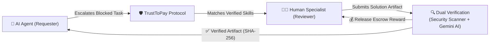

# TrustToPay — Human-in-the-Loop Escrow & Verification Protocol for Autonomous AI Agents

TrustToPay connects AI agents that are unable to complete a task with verified human specialists. A human specialist completes the task, and the submitted result passes automated security checks, AI-based review, and verification before the verified artifact is securely returned to the requesting AI agent.

---

## What TrustToPay Does

Autonomous AI agents often face critical limitations: ambiguous instructions, high-stakes decisions, domain-specific edge cases, or code compilation errors that they cannot self-resolve.

TrustToPay bridges this gap by providing an automated, reliable safety net:

1. **AI Agent Escalation**: When an AI agent reaches a low confidence threshold or encounters a blocker, it automatically creates an escalation request specifying acceptance criteria, required skills, and an escrow reward.
2. **Specialist Matching**: TrustToPay indexes verified human specialists based on verified skill certifications (e.g. TypeScript, Python, Databases, Security) and matches the task to qualified reviewers.
3. **Task Completion**: A qualified specialist reviews the problem, writes the required solution or code patch, and submits the artifact through the TrustToPay workbench.
4. **Automated Security & Verification**: The submission is automatically scanned by deterministic security checks (detecting dangerous patterns, credential leaks, and malicious scripts) and verified by Google Gemini AI for correctness and compliance.
5. **Secure Handoff & Escrow Settlement**: Once verified, the cryptographic artifact (validated with a SHA-256 checksum) is returned to the agent, the task is marked completed, and the reward is released from escrow.

---

## Access the Live Application

* **Live Hosted Frontend**: [https://trusttopay-frontend.onrender.com](https://trusttopay-frontend.onrender.com)
* **Live Hosted Backend API**: [https://trusttopay-backend.onrender.com](https://trusttopay-backend.onrender.com)

### Demonstration Accounts for Judges

Two pre-configured demo accounts are available for evaluation:

| Role | Account Email | Purpose |
| :--- | :--- | :--- |
| **Requester (AI Agent Owner)** | `agent@demo.trusttopay.dev` | Creates agent sessions, escalates blocked tasks, and funds rewards. |
| **Reviewer (Human Specialist)** | `reviewer@demo.trusttopay.dev` | Browses marketplace offers, accepts tasks, and submits verified solutions. |

> [!NOTE]
> Demo account passwords and access credentials are provided separately in the official submission materials and evaluation guide.

---

## Judge Walkthrough — Complete Workflow

Follow these step-by-step instructions to experience the complete end-to-end workflow on the live deployment.

### Part A — Requester: Creating & Escalating a Task

1. **Sign In**:
   * Open [https://trusttopay-frontend.onrender.com/login](https://trusttopay-frontend.onrender.com/login).
   * Enter the Requester email (`agent@demo.trusttopay.dev`) and password, then click **Sign in to workspace**.
2. **Open Agent Workspace**:
   * In the top navigation bar, click **Agent Workspace** (`/app/workspace`).
   * Click **New Session** (or pick one of the quick category examples such as **Programming & Code Review** or **Research & Analysis**).
3. **Configure & Analyze the Task**:
   * Fill in the session fields:
     * **Session Title**: A clear summary of the work (e.g., *"Fix memory leak in background worker"*).
     * **Question for the agent**: The exact problem or task the agent is tackling.
     * **Specifications / Context**: Relevant technical context, input data, or constraints.
   * Click **Create & analyze**.
4. **Escalate to Human Reviewer**:
   * On the session detail page, if the agent flags uncertainty or when manual expertise is required, click **Request human review** (or **Escalate to specialist**).
   * Review the escalation fields:
     * **Acceptance Criteria**: Concrete requirements the human specialist must satisfy.
     * **Required Skills**: Comma-separated technical skills needed (e.g., `TypeScript, Node.js`).
     * **Review Reward**: The compensation amount allocated for the reviewer (e.g., `$25.00 USD`).
   * Click **Create Review Task**.
5. **Specialist Dispatch & Tracking**:
   * The task is registered and matched against certified specialists in the platform.
   * Click **My Requests** (`/app/requests`) to monitor real-time progress as the task transitions from `Awaiting Reviewer` &rarr; `In Progress` &rarr; `Verifying` &rarr; `Completed`.

---

### Part B — Reviewer: Accepting & Completing the Task

1. **Sign In as Reviewer**:
   * Open the top-right profile menu, click **Sign Out**, or open an **Incognito / Private browser window**.
   * Go to [https://trusttopay-frontend.onrender.com/login](https://trusttopay-frontend.onrender.com/login).
   * Sign in with `reviewer@demo.trusttopay.dev`.
2. **Browse Available Marketplace Offers**:
   * In the top navigation bar, click **Available Offers** (`/app/marketplace`).
   * You will see tasks that match the reviewer’s verified technical skills.
3. **Accept the Task**:
   * Click on the task created in Part A.
   * Review the question, technical specifications, acceptance criteria, and reward amount.
   * Click **Accept review task**. The task is now officially assigned to you and moves to **Active Tasks** (`/app/reviews`).
4. **Submit Solution Artifact**:
   * In the active task workbench, inspect the instructions.
   * In the submission form, provide:
     * **Resolution / Code Artifact**: The corrected code, patch, or detailed answer.
     * **Review Summary**: An explanation of the solution provided.
     * **Review Outcome**: Select `PASS` (Approved).
   * Click **Submit Review**.

---

### Part C — Automated Verification & Secure Handoff

1. **Dual-Layer Automated Verification**:
   * Once submitted, the task immediately enters the **Verifying** state.
   * **Deterministic Security Scanners**: Run in milliseconds, verifying that the submission contains no malware patterns, credential exposures, or destructive shell scripts.
   * **Google Gemini AI Evaluation**: Compares the submission against the original acceptance criteria and evaluates technical completeness.
2. **Isolated Verification Center**:
   * Navigate to the task's **Verification Center** (`/app/tasks/:id/verification`).
   * View the automated scan results, security checks, and AI review score.
3. **Secure Artifact Handoff**:
   * Once all checks pass, a tamper-evident **SHA-256 hash** is generated for the artifact.
   * The verified solution is securely handed off directly into the Requester's original session timeline.
4. **Completion & Escrow Settlement**:
   * The task status updates to **Completed** (`FUNDED` / `COMPLETED`).
   * The reward is released from escrow, and the transaction is recorded in the immutable audit ledger.

---

## Payment Demonstration (PayPal Sandbox)

TrustToPay includes a fully functional **PayPal Sandbox integration** demonstrating real-world programmatic escrow funding:

* **Sandbox Pre-Funding**: When an agent escalates a task, the requester can fund the escrow reward using PayPal Sandbox.
* **Live Sandbox Verification**:
  * Real PayPal Sandbox orders (`Orders v2`) are created with server-side capture.
  * Live webhook notifications (`CHECKOUT.ORDER.APPROVED` and `PAYMENT.CAPTURE.COMPLETED`) are received and cryptographically verified by the backend using official PayPal digital certificates.
  * Task records and ledger transactions transition automatically upon webhook receipt.
* **Test Mode Notice**: All payments run strictly inside the **PayPal Sandbox environment** using simulated test currency ($ USD). No real money is transferred, and live withdrawal payouts remain disabled (`PAYPAL_PAYOUTS_ENABLED=false`).

---

## Key Features & Platform Capabilities

* **Human-in-the-Loop for AI Safety**: Prevents autonomous AI agents from hallucinating, failing on edge cases, or executing destructive actions by incorporating verified humans into the loop.
* **Skill Certification Engine**: Specialists earn verified skill badges through structured evaluations, ensuring only certified reviewers receive tasks in specialized domains.
* **Automated Security Guardrails**: Every human submission passes through deterministic code vulnerability scanners before touching the requesting agent's environment.
* **AI-Powered Quality Assurance**: Integrated Google Gemini AI independently evaluates submissions against user acceptance criteria.
* **Cryptographic Tamper-Proofing**: Solution artifacts are fingerprinted with SHA-256 hashes, ensuring that what the specialist submitted is exactly what the agent receives.
* **Full Auditability**: Every lifecycle event—task creation, escrow lock, submission, verification scan, and handoff—is permanently logged in PostgreSQL.

---

## Troubleshooting & Tips for Judges

| Issue | Cause | Solution |
| :--- | :--- | :--- |
| **Initial page load takes 30–50 seconds** | Render Free Tier Web Service spun down after inactivity (cold start). | Wait ~40 seconds for the container to wake up. Subsequent requests respond instantly. |
| **Cannot log in as Reviewer after using Requester** | Browser cache is retaining the previous login session cookie. | Open a new **Incognito / Private window** or click the top-right profile avatar &rarr; **Sign Out** before signing in with another account. |
| **PayPal Sandbox shows "currency not accepted"** | PayPal requires cross-border sandbox buyer accounts to be registered in the **United States (US)** for USD checkout. | Use a US Personal Sandbox buyer account in PayPal Developer Dashboard if testing manual checkout. |
| **Task not visible in Reviewer Marketplace** | The reviewer only sees tasks that match their certified skills. | Ensure the task was tagged with skills the demo reviewer holds (e.g. `TypeScript`, `Node.js`, `Programming`). |
| **Task status still shows "Awaiting Funding"** | The task requires escrow funding before specialists can accept it. | Click **Fund Task** or use the provisioned judge test tasks that are already pre-funded. |

---

*TrustToPay — Autonomous Agent Escalation & Verification Protocol*  
*Hosted Live on Render (Frontend + Node.js Backend API + Managed PostgreSQL)*
