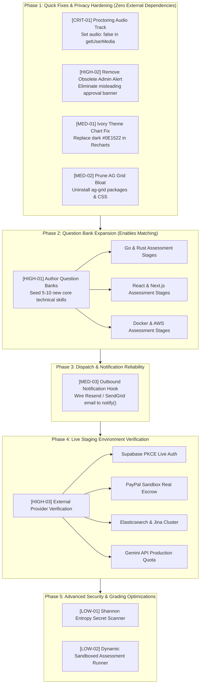

# TrustToPay — Feature Dependency Map & Remediation Sequence

**Audit Date:** 2026-11-10  
**Purpose:** Maps dependencies between incomplete, unverified, or broken features and defines the optimal sequence for the next development cycle.

---

## 1. Visual Dependency Graph

---

## 2. Dependency Breakdown by Functional Block

### Block A: Privacy & UI Corrections (Independent)
- **Target Items:** `[CRIT-01]`, `[HIGH-02]`, `[MED-01]`, `[MED-02]`
- **Dependencies:** None. These are localized within `frontend/src/pages/` and `frontend/package.json`.
- **Why First:** They resolve an immediate privacy defect, fix misleading dashboard copy, and remove 270KB of dead bundle weight without touching database schemas or backend contracts.

### Block B: Skill Question Banks Expansion
- **Target Item:** `[HIGH-01]`
- **Dependencies:** Relies on the existing `assessmentEngine.ts` and `taxonomy.ts` data structures.
- **Why Second:** 79 out of 83 taxonomy skills currently have no question bank. Without question banks, reviewers cannot certify in Go, Rust, React, or Cloud, which blocks tasks in those categories from matching verified specialists. Expanding question banks unlocks the full matching potential of the existing 50/30/20 ranking engine.

### Block C: Outbound Notification Transport
- **Target Item:** `[MED-03]`
- **Dependencies:** Depends on `backend/src/services/matching/offerDispatcher.ts` and `backend/src/lib/audit.ts`.
- **Why Third:** As more skills are certified and tasks are created, specialists need real-time email or webhook notifications before the 15-minute offer TTL expires.

### Block D: Staging & External Provider Verification
- **Target Item:** `[HIGH-03]`
- **Dependencies:** Requires obtaining external developer API credentials as outlined in [`docs/ENVIRONMENT_SETUP_GUIDE.md`](file:///C:/Users/Win11%20Pro/antigravity/TrustToPay/docs/ENVIRONMENT_SETUP_GUIDE.md).
- **Sub-tasks:**
  1. Configure Supabase project URL and anon key; verify browser PKCE login and callback redirect.
  2. Configure PayPal Developer Sandbox App with Payouts enabled; verify real order creation, capture, and sandbox payout.
  3. Deploy local or cloud Elasticsearch 8.x instance with Jina API key; verify hybrid vector + BM25 search.
  4. Test live Gemini API security evaluation with `GEMINI_API_KEY`.

### Block E: Advanced Enhancements
- **Target Items:** `[LOW-01]`, `[LOW-02]`
- **Dependencies:** Depends on stable runner infrastructure (`Dockerode` / gVisor container integration).
- **Why Last:** Non-blocking enhancements for high-entropy secret detection and dynamic test-suite execution for student assessment code.

---

## 3. Recommended Implementation Roadmap

| Sequence | Task Description | Scope | Files to Touch | Estimated Effort |
| :---: | :--- | :--- | :--- | :---: |
| **Step 1** | Disable audio track in camera stream (`audio: false`) | Privacy Fix | `frontend/src/pages/skill-assessment.tsx` | 5 mins |
| **Step 2** | Remove obsolete administrator approval alert | UI Cleanup | `frontend/src/pages/dashboard.tsx` | 5 mins |
| **Step 3** | Update Recharts Tooltip & Grid to ivory theme tokens | UI Polish | `frontend/src/pages/dashboard.tsx` | 10 mins |
| **Step 4** | Prune `ag-grid-community` and remove CSS `@import` | Bundle Optimization | `frontend/package.json`, `frontend/src/index.css` | 10 mins |
| **Step 5** | Author & seed question banks for top 6 high-demand skills | Core Content | `backend/src/services/skills/assessmentEngine.ts` | 2–3 hours |
| **Step 6** | Connect outbound email/webhook hook to `notify()` | Dispatch | `backend/src/lib/audit.ts` | 1 hour |
| **Step 7** | Staging deployment & live Sandbox validation | DevOps / QA | `.env`, Staging cloud host | 2–4 hours |
