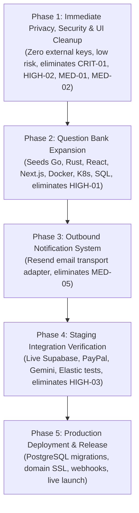

# TrustToPay — Master Implementation Roadmap for All Identified Gaps

**Document Type:** Strategic Technical Implementation Roadmap  
**Status:** Planning-Only (Approved for Engineering Review)  
**Author:** Senior Full-Stack Engineering Lead & Technical Project Manager  
**Reference Audit:** [`docs/audit/COMPLETE_FEATURE_AUDIT.md`](file:///C:/Users/Win11%20Pro/antigravity/TrustToPay/docs/audit/COMPLETE_FEATURE_AUDIT.md)  
**Creation Date:** 2026-11-10  

---

## 1. Executive Summary & Strategy

Following the complete monorepo audit across the 24 functional domains of TrustToPay, this roadmap establishes a rigorous, dependency-aware engineering sequence to close all verified gaps.

The core architecture (the human-in-the-loop task escalation protocol, top-5 50/30/20 specialist ranking, atomic offer acceptance, SHA-256 immutable multi-file artifacts, layered Gemini security gate, isolated test runner, and HMAC-signed handback) is **fully implemented and verified by 143 passing automated tests**. 

This roadmap targets the **10 genuine outstanding issues** identified in the audit:
- 1 CRITICAL privacy issue (unnecessary microphone stream initialization).
- 3 HIGH priority items (catalogue question bank coverage, obsolete administrator approval UI alert, live external staging verification).
- 3 MEDIUM priority items (outbound email/webhook notification transport, residual dark chart tokens, unused AG Grid bundle bloat).
- 3 LOW priority items (Shannon entropy secret detection, dynamic sandbox execution for assessment code, automated agent key rotation).

### Key Architectural Decisions
1. **Zero-Regression Principle:** All modifications must maintain 100% pass rate across the existing 143 test cases.
2. **Phase Independence:** Immediate privacy and UI fixes (Phase 1) require **zero external API keys** and will be completed and verified before initiating content authoring or cloud provisioning.
3. **Question Bank Quality First:** Expand question banks using curated, multi-stage engineering problems across the 7 priority technical skills rather than automated generic text generation.
4. **Decoupled Outbound Transport:** Email notification failure will never block internal task state transitions or in-app notification persistence.
5. **Smallest Safe Production Set:** The application can run production-ready with SQLite/Postgres + local session/Supabase + PayPal Sandbox + deterministic safety gate without requiring paid third-party search clusters.

---

## 2. Complete Gap Register

| Issue ID | Feature Area | Problem Description | Current Implementation | Required Changes | Priority | Dependencies | Affected Files | DB Impact | External Credentials | Testing Strategy | Acceptance Criteria |
| :--- | :--- | :--- | :--- | :--- | :---: | :--- | :--- | :---: | :---: | :--- | :--- |
| **GAP-01** | Assessment Proctoring | Microphone stream is initialized (`audio: true`), requesting unnecessary permission. | `requestCamera` in `skill-assessment.tsx` requests audio stream. | Change `audio: true` to `audio: false` in `navigator.mediaDevices.getUserMedia`. | **CRITICAL** | None | `frontend/src/pages/skill-assessment.tsx` | None | None | Unit & manual browser test: camera active, no mic prompt. | Browser requests camera only; zero microphone tracks in media stream. |
| **GAP-02** | Skills Assessment | 79 of 83 taxonomy skills lack question banks (only TS, Python, Smart Contracts, Dist. Systems seeded). | `DEFAULT_SKILLS_CATALOG` only defines 4 skills (24 questions total). | Author 3-level question banks for Go, Rust, React, Next.js, Docker, Kubernetes, SQL (42+ new questions). | **HIGH** | None | `backend/src/services/skills/assessmentEngine.ts`, `backend/src/services/skills/taxonomy.ts` | Data change (`Skill`, `AssessmentStage`) | None | Vitest `skills.test.ts` & `matching.test.ts` | All 7 priority skills seeded with L1-L3 stages and passing 80% score rules. |
| **GAP-03** | Reviewer Dashboard | Misleading alert: *"An administrator must approve your reviewer account before you can accept tasks."* | Alert rendered when `!data.approval.approved` in `ReviewerDashboard`. | Remove obsolete administrator approval banner from reviewer dashboard UI. | **HIGH** | None | `frontend/src/pages/dashboard.tsx` | None | None | React component test & visual check. | No mention of administrator on reviewer dashboard. |
| **GAP-04** | Integrations | Supabase PKCE, PayPal Sandbox, Elasticsearch, and live Gemini models unverified against real endpoints. | Fallback to local session, simulated PayPal, SQL queries, and local AST scanner. | Deploy staging harness with real sandbox keys and run automated live verification suite. | **HIGH** | Phase 1 & 2 | `.env`, Staging environment | None | Supabase, PayPal Sandbox, Gemini, Elastic | End-to-end integration test runner against live sandbox endpoints. | Real PayPal order capture & real Gemini model evaluation return 200 OK. |
| **GAP-05** | Notifications | Top-5 offer dispatch inserts into `Notification` table but lacks outbound email/webhook alerts. | `notify()` in `lib/audit.ts` only writes to Prisma database table. | Implement Resend email transport adapter with template formatting and retry circuit breaker. | **MEDIUM** | None | `backend/src/lib/audit.ts`, `backend/src/config.ts`, `backend/src/services/notifications/email.ts` | None | `RESEND_API_KEY` (Free tier) | Vitest email adapter test with mock transport & delivery assertions. | Outbound email dispatched to specialist upon offer creation. |
| **GAP-06** | UI Hygiene | Dashboard Recharts tooltips and gridlines hardcode dark colors (`#1E2B42`, `#0E1522`). | Dark colors lingering in `RequesterDashboard` session charts. | Update Recharts CartesianGrid and Tooltip styles to warm ivory tokens (`#E5E1D7`, `#FFFEFA`, `#202722`). | **MEDIUM** | None | `frontend/src/pages/dashboard.tsx` | None | None | Visual regression check on dashboard. | All chart tooltips and axes match warm ivory `#F7F5EF` theme. |
| **GAP-07** | Frontend Build | `ag-grid-community` & `ag-grid-react` packages and CSS imported but unused in code. | Listed in `package.json` and `@import` in `index.css`; 0 usages in `frontend/src/`. | Run `npm uninstall ag-grid-community ag-grid-react` in frontend and remove CSS imports. | **MEDIUM** | None | `frontend/package.json`, `frontend/src/index.css` | None | None | `npm --workspace frontend run build` | Bundle size reduced by ~270KB; zero compilation or runtime errors. |
| **GAP-08** | Security Scanner | Secret scanner relies strictly on regex patterns; lacks Shannon entropy scanning. | 8 regex patterns in `deterministicScanner.ts`. | Add high-entropy token detector for arbitrary unclassified strings (>4.5 Shannon entropy). | **LOW** | None | `backend/src/services/security/deterministicScanner.ts` | None | None | Unit test with high-entropy vs normal code strings. | Detects raw high-entropy base64/hex strings while ignoring camelCase code identifiers. |
| **GAP-09** | Assessment Runner | Assessment code submissions graded by AST snippet matching rather than test runner. | `gradeAssessmentQuestions` checks `requiredSnippets` & `forbiddenSnippets`. | Optionally wire code tasks into the isolated sandbox runner for dynamic evaluation. | **LOW** | Phase 1 | `backend/src/services/skills/assessmentEngine.ts` | None | Docker/Runner | Unit test executing student code tasks in sandbox. | Student code passes if runtime test suite exits 0; failures output test logs. |
| **GAP-10** | Agent Auth | Agent API keys (`ttp_*`) lack automated expiration dates and user-facing rotation UI. | Stored in `AgentApiKey` with manual creation and revocation. | Add `expiresAt` field and rotation endpoint `POST /api/v1/auth/agent-keys/:id/rotate`. | **LOW** | None | `backend/prisma/schema.prisma`, `backend/src/routes/users.ts` | Migration (`AgentApiKey.expiresAt`) | None | Agent auth unit tests with expired vs active keys. | Expired agent keys rejected with 401; rotation issues new key atomically. |

---

## 3. Workstream Execution Plans

### Workstream A: Immediate Privacy & Security Corrections
- **Objective:** Eliminate unnecessary device permission requests, verify role boundaries, and purge obsolete administrator approval artifacts.
- **Microphone Stream Removal:** In `frontend/src/pages/skill-assessment.tsx`, update the `navigator.mediaDevices.getUserMedia` parameters to `{ video: { width: { ideal: 640 }, height: { ideal: 480 }, facingMode: "user" }, audio: false }`. Update UI copy to display *"Webcam Stream"* instead of *"Webcam & Microphone Feed"*.
- **Administrator Alert Removal:** In `frontend/src/pages/dashboard.tsx`, delete lines 300–306 containing `<Alert tone="warning">An administrator must approve your reviewer account...</Alert>`.
- **Reviewer Auto-Approval Verification:** Confirm that `backend/src/routes/auth.ts` sets `isReviewerApproved: true` upon reviewer registration. Ensure seed scripts also set `isReviewerApproved: true` across all test specialists.

### Workstream B: Skill Assessment Expansion
- **Objective:** Scale assessment coverage from 4 skills to 11 skills (covering the 7 highest-demand technical domains in AI engineering).
- **Target Skills:**
  1. `go` (Go Programming)
  2. `rust` (Rust Systems)
  3. `react` (React UI Engineering)
  4. `nextjs` (Next.js & Server Components)
  5. `docker` (Docker Containerization)
  6. `kubernetes` (Kubernetes Orchestration)
  7. `sql` (SQL Optimization & Modeling)
- **Question Structure per Skill:**
  - **Level 1 (Foundation):** 1 Multiple Choice (syntax/core primitives) + 1 Code Task (safe implementation of basic construct). Passing score: 80%. Cooldown: 30 mins.
  - **Level 2 (Practitioner):** 1 Multiple Choice (concurrency, error boundaries, transactions) + 1 Code Task (resilient pattern implementation). Passing score: 80%. Cooldown: 45 mins.
  - **Level 3 (Advanced):** 1 Multiple Choice (distributed state, zero-copy, memory fencing) + 1 Code Task (production-hardened implementation). Passing score: 80%. Cooldown: 60 mins.
- **Architectural Preservation:**
  - Exactly 1 randomly selected question served per level using `crypto.randomInt`.
  - Client API response strips `correctOptionId`, `requiredSnippets`, `forbiddenSnippets`, and `explanation`.
  - Answer options are shuffled via Fisher-Yates with `crypto.randomInt`.
  - Sequential unlocking: L2 requires passed L1; L3 requires passed L2.
  - Retake safety: Failing L2 or L3 never revokes an already-earned L1 credential.
- **Longer-Term Catalogue Strategy:**
  - Establish a shared framework where related sub-disciplines share architectural question templates (e.g., Python / Pandas share Python runtime mechanics; Vue / Svelte share reactive compiler principles).

### Workstream C: Outbound Reviewer Notifications
- **Objective:** Alert offered specialists in real time before the 15-minute offer TTL expires.
- **Provider Evaluation:**
  - **Resend (Recommended):** Modern Node.js SDK, 3,000 free emails/month (100/day), zero upfront cost, simple API key (`RESEND_API_KEY`).
  - **SendGrid:** 100 emails/day free tier, but complex sender identity and domain verification requirements.
  - **SMTP / Nodemailer:** Requires dedicated SMTP host credentials.
- **Implementation Architecture:**
  - Create `backend/src/services/notifications/email.ts`.
  - When `RESEND_API_KEY` is present, dispatches outbound HTML/text email asynchronously.
  - If `RESEND_API_KEY` is empty, logs notification to console and returns cleanly (graceful fallback).
  - Outbound email dispatch is wrapped in `try/catch` and will **never throw or block** `dispatchTopOffers()`.
  - Database `Notification` table remains the persistent source of truth for in-app notification center.

### Workstream D: Dashboard & UI Cleanup
- **Objective:** Eliminate visual inconsistencies and purge unused bundle dependencies.
- **Ivory/Cream Chart Theming:**
  - In `frontend/src/pages/dashboard.tsx`, replace Recharts CartesianGrid stroke `#1E2B42` with `#E5E1D7`.
  - Replace Tooltip `contentStyle` background `#0E1522` and border `#1E2B42` with `backgroundColor: "#FFFEFA"`, `borderColor: "#E5E1D7"`, and `color: "#202722"`.
- **AG Grid Pruning:**
  - Verify that no source file in `frontend/src/` imports `ag-grid`.
  - Run `npm --workspace frontend uninstall ag-grid-community ag-grid-react`.
  - In `frontend/src/index.css`, delete `@import "ag-grid-community/styles/ag-grid.css";` and `@import "ag-grid-community/styles/ag-theme-quartz.css";`.
  - Re-run `npm --workspace frontend run build` to confirm clean compilation and verify bundle size reduction.

### Workstream E: External Integration Verification (Staging Phase)
- **Objective:** Validate real third-party network communication against live sandbox endpoints without impacting production stability.
- **Verification Matrix:**
  1. **Supabase Auth:** Configure test project URL and anon key; verify browser PKCE signup, confirmation email receipt, token exchange, and session refresh.
  2. **PayPal Sandbox:** Configure sandbox Client ID and Secret; execute $15.00 order creation, PayPal popup checkout approval, server-side capture, and webhook signature verification on `POST /api/v1/paypal/webhook`.
  3. **Google Gemini:** Supply test `GEMINI_API_KEY`; execute live code security scan on sample code artifact; verify JSON schema conformance and test fail-closed timeout by supplying an invalid endpoint.
  4. **Elasticsearch 8.x:** Connect to test cluster; index sample specialist documents; verify hybrid kNN vector + lexical BM25 retrieval.

### Workstream F: Core TrustToPay Workflow Verification
- **Objective:** Validate the entire human-in-the-loop lifecycle with newly added skills and sanitized endpoints.
- **Execution Checklist:**
  - Agent task escalation & budget enforcement ($5–$100).
  - Top-5 parallel offer dispatch to newly seeded Go/Rust specialists.
  - Atomic single-winner acceptance under concurrent load.
  - Specialist multi-file deliverable upload.
  - Deterministic SHA-256 digest calculation.
  - Gemini security gate PASS verdict.
  - Isolated acceptance test execution (exit code 0).
  - HMAC-SHA256 signed handback delivery to agent.

### Workstream G: Agent Skill & MCP Developer Experience
- **Objective:** Ensure external agent frameworks (Claude Desktop, Cursor, VS Code, Python SDK) connect cleanly without errors.
- **Verification Checklist:**
  - Run `@trusttopay/mcp-server` over STDIO transport; verify clean stdout (zero diagnostic pollution).
  - Run `@trusttopay/mcp-server` over Streamable HTTP transport; test `trusttopay_create_task` and `trusttopay_get_verified_result`.
  - Test client configuration files in `integrations/examples/mcp-client-configs/`.
  - Execute `integrations/examples/typescript/agent-escalation-example.ts`.
  - Execute `integrations/examples/python/agent_escalation_example.py`.

### Workstream H: Environment & Deployment Readiness
- **Objective:** Formulate zero-downtime deployment plan for staging and production.
- **Smallest Safe Production Set:**
  - Cloud Run or VPS container running Backend + Vite Frontend.
  - PostgreSQL database (Supabase Managed Postgres or standard cloud RDS).
  - Mandatory variables: `NODE_ENV=production`, `PORT=8080`, `DATABASE_URL`, `SESSION_SECRET`, `FRONTEND_URL`, `API_BASE_URL`.
  - PayPal Sandbox mode enabled initially for end-to-end checkout.
  - Gemini API key for live security reviews.
  - Elasticsearch and Jina AI remain optional (relational database candidate matching handles initial traffic seamlessly).

---

## 4. Phased Implementation Plan



### Phase 1: Immediate Privacy, Security & UI Cleanup
- **Goal:** Fix immediate privacy violation, remove confusing administrator copy, align chart colors with ivory design system, and prune dead bundle weight.
- **Gaps Resolved:** `GAP-01`, `GAP-03`, `GAP-06`, `GAP-07`.
- **Exact Tasks:**
  1. Edit `frontend/src/pages/skill-assessment.tsx`: set `audio: false` in `getUserMedia` and update UI copy.
  2. Edit `frontend/src/pages/dashboard.tsx`: remove the obsolete administrator approval alert block.
  3. Edit `frontend/src/pages/dashboard.tsx`: replace dark Recharts colors with warm ivory tokens.
  4. Uninstall `ag-grid-community` and `ag-grid-react` from `frontend/package.json` and remove CSS imports in `index.css`.
  5. Run test suite: `npm run test` (confirm 143 tests pass).
  6. Run production build: `npm --workspace frontend run build` (verify zero errors and reduced bundle size).
- **External Keys Required:** None.
- **Database Changes:** None.

### Phase 2: Assessment Question Bank Expansion
- **Goal:** Scale verified skill coverage across Go, Rust, React, Next.js, Docker, Kubernetes, and SQL.
- **Gaps Resolved:** `GAP-02`.
- **Exact Tasks:**
  1. In `backend/src/services/skills/assessmentEngine.ts`, expand `DEFAULT_SKILLS_CATALOG` with definitions for the 7 priority skills.
  2. Author 6 questions per skill (2 Foundation, 2 Practitioner, 2 Advanced; 1 Multiple Choice + 1 Code Task per level).
  3. In `backend/src/services/skills/taxonomy.ts`, update `isAssessed: true` for the 7 expanded skills.
  4. Write automated test in `backend/src/test/skills.test.ts` verifying that all 11 assessed skills load stages, shuffle options, strip secrets, and calculate scores correctly.
  5. Run `npx prisma db push` and `npm run seed` to ensure stages populate cleanly in SQLite.
  6. Run full test suite: `npm run test`.
- **External Keys Required:** None.
- **Database Changes:** Data change (seeds new rows in `Skill` and `AssessmentStage`).

### Phase 3: Outbound Notification System
- **Goal:** Dispatch real-time email alerts to specialists when top-5 parallel offers are issued.
- **Gaps Resolved:** `GAP-05`.
- **Exact Tasks:**
  1. Add optional `RESEND_API_KEY` to `backend/src/config.ts`.
  2. Implement `backend/src/services/notifications/email.ts` with Resend SDK or standard HTTP fetch to `https://api.resend.com/emails`.
  3. Wire email dispatch into `notify()` in `backend/src/lib/audit.ts` for offer creation events.
  4. Add unit test with mock HTTP transport verifying email generation, template rendering, and error isolation (non-blocking).
- **External Keys Required:** `RESEND_API_KEY` (Free tier).
- **Database Changes:** None.

### Phase 4: Staging Integration Verification
- **Goal:** Verify external provider integrations against live sandbox servers.
- **Gaps Resolved:** `GAP-04`.
- **Exact Tasks:**
  1. Provision Supabase test project; add `VITE_SUPABASE_URL` and `VITE_SUPABASE_ANON_KEY` to test environment; verify PKCE authentication and JWT validation.
  2. Configure PayPal Developer Sandbox App; set `DEMO_MODE=false`; test real order creation, capture, and sandbox payout.
  3. Configure `GEMINI_API_KEY`; verify real code security evaluation and fail-closed timeout behavior.
  4. Run end-to-end integration test runner against live sandbox endpoints.
- **External Keys Required:** Supabase project keys, PayPal Sandbox credentials, Google Gemini API key.
- **Database Changes:** None.

### Phase 5: Production Deployment & Release
- **Goal:** Production rollout on PostgreSQL with production secrets and verified webhooks.
- **Gaps Resolved:** Deployment readiness.
- **Exact Tasks:**
  1. Provision managed PostgreSQL database (Supabase or cloud RDS).
  2. Run `npx prisma migrate deploy` or `npx prisma db push` against PostgreSQL URI.
  3. Seed baseline skills taxonomy and question banks.
  4. Deploy backend container with production environment variables (`NODE_ENV=production`, generated `SESSION_SECRET`).
  5. Deploy static frontend to CDN / hosting provider.
  6. Register PayPal Sandbox / Live Webhook URL: `https://api.trusttopay.com/api/v1/paypal/webhook`.
  7. Run smoke tests across landing page, registration, task creation, and MCP server endpoints.

---

## 5. Cost & Resource Analysis

| Phase | Relative Effort | External Accounts Needed | Expected Infrastructure Cost | Primary Technical Risks |
| :---: | :---: | :--- | :---: | :--- |
| **Phase 1** | **Small** (1–2 hours) | None | **$0** (Free) | Low. CSS regression risk (mitigated by visual check). |
| **Phase 2** | **Medium** (3–4 hours) | None | **$0** (Free) | Low. Question syntax or validation snippet mismatch (mitigated by automated unit tests). |
| **Phase 3** | **Small** (1–2 hours) | Resend (Free account) | **$0** (3,000 free emails/mo) | Low. Outbound email delivery failure (mitigated by non-blocking try/catch). |
| **Phase 4** | **Medium** (2–4 hours) | Supabase, PayPal Developer, Google AI Studio | **$0** (All developer free tiers) | Medium. Network timeouts on external APIs (mitigated by circuit breakers and fallbacks). |
| **Phase 5** | **Medium** (2–4 hours) | Cloud Host (Cloud Run / VPS), Managed PostgreSQL | **$0–$15/month** | Medium. PostgreSQL connection pooling and SSL certificate configuration. |

---

## 6. Testing & Acceptance Matrix

```
┌────────────────────────────────────────────────────────────────────────┐
│               TRUSTTOPAY VERIFICATION PIPELINE GATES                   │
├────────────────────────────────────────────────────────────────────────┤
│  1. Privacy Gate: Zero mic tracks in getUserMedia()                    │
│  2. Visual Gate: Warm ivory design tokens (#F7F5EF / #FFFEFA)          │
│  3. Bundle Gate: AG Grid pruned; dist assets < 1.2MB total             │
│  4. Assessment Gate: 11 skills seeded with L1-L3 stages (80% pass rule)│
│  5. Security Gate: Secrets blocked before Gemini; fail-closed active   │
│  6. Handback Gate: 3-stage condition check + exact SHA-256 match       │
│  7. Build Gate: tsc (0 errors) + vitest (143+ tests passing)           │
└────────────────────────────────────────────────────────────────────────┘
```

1. **Phase 1 Acceptance:**
   - Pre-flight proctoring modal connects webcam and screen share with zero microphone requests.
   - Reviewer dashboard displays zero mentions of an administrator.
   - Recharts tooltips use background `#FFFEFA` and border `#E5E1D7`.
   - `npm --workspace frontend run build` completes with zero errors and no AG Grid references.
   - All 143 existing tests pass.
2. **Phase 2 Acceptance:**
   - `GET /api/v1/skills` returns all 11 skills with active L1–L3 stages.
   - Starting an assessment for Go, Rust, or React selects exactly 1 unpredictable question per level.
   - Completing an assessment updates `UserSkillLevel` and `ReviewerSkill` records.
   - Matching tasks requiring Go L2 successfully rank and dispatch offers to qualified reviewers.
3. **Phase 3 Acceptance:**
   - Creating a task with matching specialists generates outbound email notifications via Resend adapter.
   - Disabling `RESEND_API_KEY` logs a clean console warning without crashing the offer dispatcher.
4. **Phase 4 Acceptance:**
   - Real PayPal Sandbox checkout creates order, captures payment, and logs ledger transaction.
   - Live Gemini API review evaluates deliverables and enforces fail-closed behavior on mock timeout.
5. **Phase 5 Acceptance:**
   - Application boots cleanly on PostgreSQL with `NODE_ENV=production`.
   - `/health` endpoint returns `{"status": "ok"}`.
   - Programmatic MCP tools execute end-to-end over STDIO and HTTP transports.
