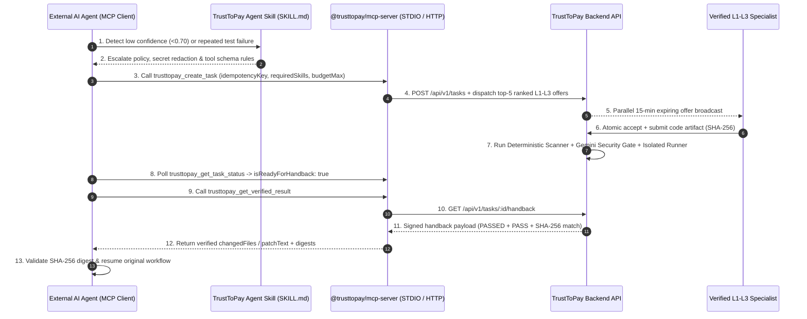

# TrustToPay Developer Integration Kit

Welcome to the official **TrustToPay Developer Integration Kit**. This directory contains everything needed to equip external AI coding agents, autonomous orchestrators, and IDE assistants with human-in-the-loop L1–L3 specialist verification and cryptographic code handback.

---

## Directory Structure

```text
integrations/
├── README.md                                  # Overview & integration architecture
├── agent-skills/
│   └── trusttopay/
│       └── SKILL.md                           # Distributable Agent Skills specification file
├── mcp-server/
│   └── README.md                              # Deployment & transport guide for @trusttopay/mcp-server
└── examples/
    ├── mcp-client-configs/
    │   ├── claude_desktop_config.json         # Claude Desktop / Claude Code STDIO config
    │   ├── cursor_mcp.json                    # Cursor IDE (.cursor/mcp.json) STDIO config
    │   ├── vscode_mcp.json                    # VS Code (.vscode/mcp.json) config
    │   └── streamable_http_client.json        # Remote Streamable HTTP client config
    ├── typescript/
    │   ├── README.md
    │   └── agent-escalation-example.ts        # Full TypeScript MCP Client SDK integration example
    └── python/
        ├── README.md
        └── agent_escalation_example.py        # Full Python agent escalation & handback workflow
```

---

## End-to-End Agent Escalation Architecture



---

## Quick Links

- **Canonical Agent Skill Package**: [`/skills/trusttopay/SKILL.md`](../skills/trusttopay/SKILL.md)
- **Official MCP Server Package**: [`/packages/trusttopay-mcp`](../packages/trusttopay-mcp)
- **Developer Guides**:
  - [Agent Skill Setup Guide](../docs/developers/AGENT_SKILL_SETUP.md)
  - [MCP Server Setup Guide](../docs/developers/MCP_SETUP.md)
  - [Agent API & Tool Reference](../docs/developers/AGENT_API_REFERENCE.md)
